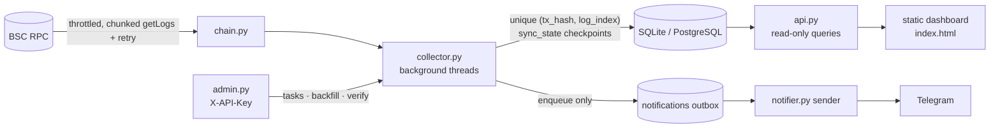

# BSC · PancakeSwap V3 LP Monitor

Monitors PancakeSwap V3 pools and wallet LP positions on BNB Smart Chain: pool prices, swaps, position events, net-fee accounting and Telegram alerts, with ingestion that is safe to restart and easy to verify against the chain.


> **Status: work in progress.** This is an unfinished demo. The known simplifications are listed [below](#known-simplifications).

## Architecture



## Highlights

- **Idempotent ingestion.** Swaps are deduplicated by a database unique constraint on `(tx_hash, log_index)`, the natural coordinates of an on-chain log. Re-scans and restarts hit the constraint and skip the row, so no in-memory bookkeeping is needed.
- **Checkpointed resume.** Each collected object has a `sync_state` row whose `last_block` only advances after every page of logs in that range has been stored. After a crash, collection resumes from `last_block + 1`.
- **Exact V3 math.** `sqrtPriceX96` → price, tick → sqrt price and liquidity → token amounts are done in `Decimal`, and amounts are stored as strings, because `uint256` values exceed float precision (`app/v3math.py`).
- **Fees are not principal.** `DecreaseLiquidity` only moves tokens into `tokensOwed`; `Collect` actually pays out. Fees are computed as cumulative Collect − cumulative Decrease (`app/accounting.py`, `tests/test_accounting.py`).
- **Detection is decoupled from delivery.** Collectors only write a row to the `notifications` outbox; a separate sender thread handles Telegram rate limits and retries, and a `dedup_key` constraint ensures one message per event per chat. Alerts fire on state changes (e.g. in-range → out-of-range), not on every sample.
- **Verifiable.** An admin endpoint backfills a block range and another compares the chain with the database row by row, reporting `missing`, `extra` and `duplicates_in_db`.

## Tech Stack

Python · FastAPI · Uvicorn · web3.py · SQLAlchemy 2 · SQLite (default) or PostgreSQL 16 via Docker Compose · python-dotenv · pytest · httpx · vanilla HTML/JS dashboard

## Getting Started

```bash
python -m venv .venv && source .venv/bin/activate    # Windows: .venv\Scripts\activate
pip install -r requirements.txt
cp .env.example .env                                 # edit RPC_URL if needed
uvicorn app.main:app --port 8000                     # do NOT use --reload: it would start two collector threads
```

Open <http://localhost:8000>. The first start takes 1–3 minutes on a public RPC: swaps are back-scanned 120,000 blocks and position events 400,000 blocks by default (`SWAP_LOOKBACK_BLOCKS`, `POSITION_LOOKBACK_BLOCKS`).

- **PostgreSQL instead of SQLite:** `docker compose up -d`, then set `DATABASE_URL` in `.env` to the Postgres URL shown in `.env.example`.
- **Upgrading from an older run:** delete `monitor.db`; there are no migrations and `create_all` does not add columns.
- **Tests:** `python -m pytest`
- **Telegram (optional):** put a @BotFather token in `TELEGRAM_BOT_TOKEN`, restart, add the bot to a chat and send `/sub all`. Commands: `/pool`, `/wallet`, `/sub liquidity|range|errors|all`, `/unsub <topic>`, `/subs`, `/replay <NFT ID>`.

### Admin API (header `X-API-Key: <ADMIN_API_KEY>`)

| Action | Endpoint |
|---|---|
| List tasks (paged, filter by status) | `GET /api/admin/tasks?page=1&size=20&status=active` |
| Add task | `POST /api/admin/tasks` with `{"kind":"pool","address":"0x..."}` |
| Pause / resume / delete | `POST .../{id}/pause` · `POST .../{id}/resume` · `DELETE .../{id}` |
| Delete stored data | `DELETE .../{id}/data` |
| Backfill swaps | `POST .../{id}/backfill?from_block=A&to_block=B` |
| Verify chain vs. DB | `GET .../{id}/verify?from_block=A&to_block=B` |
| Health / API docs | `GET /api/health` · `GET /docs` |

## Project Structure

```text
app/
├── config.py       # all settings from .env
├── chain.py        # web3 connection, minimal ABIs, chunked getLogs, throttling, retry
├── v3math.py       # Decimal V3 price / tick / liquidity math
├── models.py       # 10 tables, unique constraints, sync_state checkpoints
├── collector.py    # pool polling, swap scanning, position sync, snapshots, backfill/verify
├── accounting.py   # pure functions: cash-flow split and net-fee accounting
├── api.py          # read-only query endpoints with stale/coverage flags
├── notifier.py     # outbox, sender, bot commands, history replay
├── admin.py        # task management, backfill, verify, API-key auth
└── static/index.html
tests/              # V3 math, accounting, notification dedup and retry
docs/README.zh-CN.md  # original Chinese design notes and verification checklist
docker-compose.yml  # optional PostgreSQL
```

## Results / Learnings

- The test suite (`tests/`) covers the V3 math, the fee accounting and the outbox's dedup and retry behavior; it passed 9/9 when this README was written.
- A manual verification checklist (spot-checking swaps and prices on BscScan, simulating RPC and Telegram failures, crash/restart, pause/resume gaps) is in [`docs/README.zh-CN.md`](docs/README.zh-CN.md#四验证清单).
- Coverage is reported honestly: 24h volume only counts the collected range and returns `covered_from`, and a failed RPC call marks data as stale instead of showing zeros.

### Known simplifications

- Valuation converts all historical flows at the current price, not the price at each event; gas, swap costs and NFT cost basis are ignored.
- Positions staked in MasterChefV3 are owned by the MasterChef contract, so `balanceOf(wallet)` does not see them.
- `tokensOwed` is only settled when a position is touched, so unclaimed fees may be underestimated.
- Reorg handling relies on confirmation depth only (default 15 blocks); there is no parentHash rollback.
- No migrations, threads instead of asyncio, a single static API key, and backfill/verify only for swaps.
- The ABIs in `chain.py` are hand-written minimal versions; check event signatures against BscScan before relying on them.

---

*Documentation and repository cleanup were done with AI assistance (Claude Code); the project code and results are my own.*

## 中文说明

本项目监控 BNB Smart Chain 上 PancakeSwap V3 的池子与钱包流动性仓位，包括价格、Swap、仓位事件、手续费核算和 Telegram 告警。目前是**开发中的半成品**。

设计重点是采集过程「可重启、可校验」：

- 以 `(tx_hash, log_index)` 唯一约束去重；
- 用 `sync_state` 断点续采；
- V3 数学全部使用 `Decimal`；
- 手续费按「累计 Collect − 累计 Decrease」核算；
- 告警采用发件箱模式，与采集解耦；
- 管理接口支持对任意区块范围做补采，以及链上与库内的逐条比对。

运行方法见上方 Getting Started。完整的中文设计说明和验证清单见 [`docs/README.zh-CN.md`](docs/README.zh-CN.md)。
